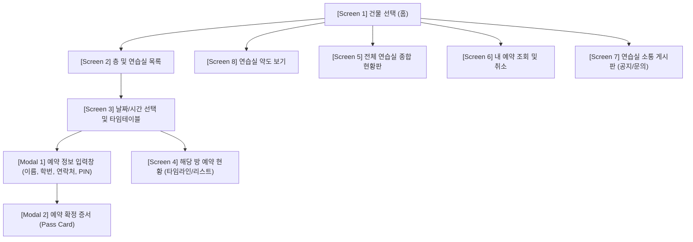

# 📖 총신대학교 교회음악과 연습실 예약 시스템 종합 명세서 및 운영 가이드

**문서 번호**: CSU-MUSIC-ROOM-SPEC-2026  
**최종 개정일**: 2026년 11월 22일  
**적용 대상**: 총신대학교 교회음악과 재학생, 조교, 학과 교수진, 시스템 관리자  
**시스템 버전**: v2.6 (Realtime Cloud Sync & A11y Accessible Edition)

---

## 목차 (Table of Contents)
1. [시스템 개요 및 운영 목적](#1-시스템-개요-및-운영-목적)
2. [공간 및 시설 마스터 데이터 (총 45개실)](#2-공간-및-시설-마스터-데이터-총-45개실)
3. [전체 사용자 화면(UI) 구성 및 흐름도](#3-전체-사용자-화면ui-구성-및-흐름도)
4. [핵심 예약 정책 및 비즈니스 룰](#4-핵심-예약-정책-및-비즈니스-룰)
5. [특수 스케줄 및 접근 통제 규정](#5-특수-스케줄-및-접근-통제-규정)
6. [관리자 통합 포털 (Admin Console)](#6-관리자-통합-포털-admin-console)
7. [기술 아키텍처 및 클라우드 동기화](#7-기술-아키텍처-및-클라우드-동기화)
8. [웹 접근성 (A11y) 및 포용적 설계](#8-웹-접근성-a11y-및-포용적-설계)
9. [사용자별 실전 이용 매뉴얼 (가이드)](#9-사용자별-실전-이용-매뉴얼-가이드)

---

## 1. 시스템 개요 및 운영 목적

### 1.1 배경 및 목적
총신대학교 교회음악과는 오르간, 피아노, 성악, 작곡, 관현악 등 전공 특성상 다수의 연습실과 특수 악기(파이프/전자 오르간, 그랜드 피아노)를 필요로 합니다. 기존의 수기 장부 작성이나 단체 메신저를 통한 예약 방식에서 발생하던 **중복 예약 충돌, 특정 인원의 독점, 무단 불참(No-Show), 시설 점검 시 정보 전달 지연** 등의 문제를 해결하기 위해 구축된 **실시간 모바일 퍼스트 온라인 연습실 예약 관리 플랫폼**입니다.

### 1.2 핵심 운영 철학
1. **공정성 (Fairness)**: 1인 1일 최대 횟수, 1회 최대 시간, 쿨다운(대기시간) 제도를 통해 소수 학생의 연습실 독점을 원천 차단합니다.
2. **투명성 (Transparency)**: 모든 학생이 전체 연습실 현황판을 통해 실시간 이용 상태를 언제 어디서나 투명하게 열람할 수 있습니다.
3. **자율성과 보안 (Autonomy & Privacy)**: 별도의 복잡한 회원가입 없이 **학번과 본인 확인용 4자리 비밀번호(PIN)**로 간편하게 즉시 예약하되, 타인의 무단 조회 및 악의적 취소를 방지합니다.
4. **포용성 (Inclusivity & Accessibility)**: 시각장애인 학생이 스마트폰 스크린 리더(TalkBack/VoiceOver)를 통해 **혼자서도 아무런 제약 없이 소리로 안내받으며 예약**할 수 있는 웹 접근성 표준을 준수합니다.

---

## 2. 공간 및 시설 마스터 데이터 (총 45개실)

시스템은 **신관(33개실)**과 **종합관(12개실)** 총 45개의 연습실을 통합 관리합니다. 관리자 포털에서 각 방의 이름과 악기 구분 배지를 실시간으로 변경할 수 있으며, 변경 즉시 전체 학생 화면에 동기화됩니다.

### 2.1 신관 (총 33개실)
지하 1층(오르간 및 공용실), 5층(일반실), 6층(학회실, 오르간, 그랜드 피아노)으로 구성되어 있습니다.

| 층 | 호수 | 기본 악기 및 용도 | 내부 카테고리 | 비고 및 시설 특징 |
| :--- | :--- | :--- | :--- | :--- |
| **B1 (지하1층)** | B06 ~ B11 | 유교 (유아교육과) | 일반실 (`normal`) | 6개실 |
| | **B12, B13** | **교음(오르간)** | **오르간실 (`organ`)** | **파이프/전자 오르간 구비 (핵심 실)** |
| | B14 | 아동 (아동학과) | 일반실 (`normal`) | 1개실 |
| | B15 ~ B17 | 교음 | 일반실 (`normal`) | 3개실 |
| | **B18** | **교음(그랜드)** | **그랜드실 (`grand`)** | **그랜드 피아노 구비** |
| **5F (5층)** | 507 ~ 510 | 교음 | 일반실 (`normal`) | 4개실 |
| **6F (6층)** | 611, 623~626 | 교음 | 일반실 (`normal`) | 5개실 |
| | **612** | **성악학회실** | **학회실 (`society`)** | 성악 전공 학회 연습실 |
| | **613** | **오르간학회실** | **학회실 (`society`)** | 오르간 전공 학회 연습실 |
| | **614** | **관현악학회실** | **학회실 (`society`)** | 관현악 전공 학회 연습실 |
| | **615** | **작곡학회실** | **학회실 (`society`)** | 작곡 전공 학회 연습실 |
| | **616** | **피아노학회실** | **학회실 (`society`)** | 피아노 전공 학회 연습실 |
| | **617 ~ 621** | **교음(오르간)** | **오르간실 (`organ`)** | **오르간 전공 집중 연습실 (5개실)** |
| | **622** | **교음(그랜드)** | **그랜드실 (`grand`)** | **그랜드 피아노 구비** |

> **층별 약도 뷰어 탑재**: 신관 지하 1층 약도 이미지가 시스템에 탑재되어 있어, 학생들이 복도 구조와 각 방 위치(B06~B18)를 그래픽으로 바로 확인할 수 있습니다.

### 2.2 종합관 (총 12개실)
종합관 2층에 위치하며 피아노 실습 위주로 운영됩니다.

| 층 | 호수 | 기본 악기 및 용도 | 내부 카테고리 | 비고 및 시설 특징 |
| :--- | :--- | :--- | :--- | :--- |
| **2F (2층)** | 1호, 5호, 7호 | 업라이트 피아노 | 일반실 (`normal`) | 5호는 업라이트 2대 구비 |
| | 2호, 11호 | 피아노 일반 | 일반실 (`normal`) | 2개실 |
| | **3, 4, 6, 8, 9, 10호** | **그랜드 피아노** | **그랜드실 (`grand`)** | **전공 실기 연습용 그랜드 6개실** |
| | **12호** | **업라이트·오르간** | **오르간실 (`organ`)** | 복합 악기 구비 실 |

### 2.3 운영 시간 및 타임 슬롯 (총 26개 슬롯)
- **운영 시간**: 매일 **09:00 ~ 22:00** (총 13시간)
- **예약 단위**: **30분 단위 블록 슬롯** (채플 시간대 11:00~11:40, 11:40~12:00 정밀 분할 반영)
- **하루 총 슬롯**: 방 1개당 하루 26개 슬롯 제공 (45개실 × 26 = 일일 총 1,170개 예약 타임 블록 운영)

---

## 3. 전체 사용자 화면(UI) 구성 및 흐름도

사용자 화면은 모바일 브라우저에 최적화된 Single Page Application(SPA) 구조로 개발되어 앱을 설치하지 않고도 네이티브 앱과 동일한 반응 속도를 제공합니다.

### 3.1 화면별 상세 기능
1. **Screen 1: 건물 선택 (홈 화면)**
   - 신관(33실)과 종합관(12실) 대형 비주얼 카드 제공
   - 건물 카드 바로 아래 **'연습실 약도 보기'** 버튼 배치
   - 상단 헤더: 내 오늘 예약 건수 알림 배지 카운터
2. **Screen 2: 층 및 연습실 선택**
   - 상단 스티키 탭: `전체`, `B1`, `5F`, `6F` (또는 종합관 `2F`) 원터치 필터
   - 연습실 카드: 방 번호, 전공 배지, **실시간 상태 표시(● 현재 사용중 / ○ 이용 가능)**, 오늘 예약 건수
   - 시설 점검 중인 방은 하단 **'예약 불가 연습실'** 섹션으로 자동 격리 분리
3. **Screen 3: 날짜 및 시간 예약 (인터랙티브 타임테이블)**
   - 날짜 변경 네비게이터 (`‹`, `›`, 터치 캘린더 팝업)
   - 상단 수동 시간 선택 셀렉트 박스 (시작~종료 시간)
   - 중앙 비주얼 타임테이블: 30분 단위 슬롯을 터치하여 최대 2시간(4개)까지 드래그하듯 연속 선택
   - 하단 플로팅 바: 선택한 총 시간 표시 및 **'이 시간으로 예약 신청하기'** 확정 버튼
4. **Screen 4: 해당 방 예약 현황**
   - 선택한 방의 하루 스케줄을 **타임라인 바(Timeline View)** 및 **상세 목록(List View)**으로 전환 열람
5. **Screen 5: 전체 연습실 종합 현황판 (대시보드)**
   - 건물별(신관/종합관) 전체 방의 시간대별 가동 현황을 한 화면에서 브라우징
   - 지금 당장 비어있는 방, 예약 완료된 방의 통계를 상단 요약 카드로 제공
6. **Screen 6: 내 예약 확인 및 취소**
   - 학번과 4자리 비밀번호 입력 시 본인의 예약 내역(이용 대기 / 이용 완료 / 취소 내역) 카드 조회
   - 예약 시작 30분 전까지 **'예약 취소하기'** 원클릭 수행
7. **Screen 7: 연습실 소통 게시판**
   - **공지게시판**: 학과 조교실의 공식 공지사항 확인
   - **문의게시판**: 시설 고장, 조율 요청 등 문의 등록 (관계자 공개 / 전체 공개 선택)
8. **Screen 8: 층별 약도 뷰어**
   - 건물별/층별 탭으로 구성되어 있으며, 현재 신관 지하 1층 약도 그래픽 탑재

---

## 4. 핵심 예약 정책 및 비즈니스 룰

시스템의 모든 정책은 관리자가 별도의 코드 수정 없이 `admin.html` 정책 설정 탭에서 실시간으로 변경할 수 있으며, 기본값으로 아래의 엄격한 공정성 알고리즘이 적용됩니다.

### 4.1 당일 예약제 (새벽 5:00 오픈)
- **규정**: 연습실 예약은 **이용 당일 새벽 05:00**에 오픈됩니다.
- **차단 정책**:
  - **새벽 5시 이전 당일**: "당일 예약 오픈 대기 중 (새벽 05:00 이후 예약 가능)" 메시지와 함께 슬롯 잠금.
  - **내일 이후 (미래 날짜)**: 미리 며칠 치를 사재기하는 행위를 방지하기 위해 조회는 가능하되 예약 신청 차단.
  - **과거 날짜**: 조회만 가능하며 신청 불가.

### 4.2 주일(일요일) 전면 휴관
- **규정**: 매주 일요일은 연습실을 운영하지 않습니다.
- **차단 정책**: 날짜 선택 시 요일이 일요일이면 모든 슬롯이 🔒 자물쇠 아이콘과 함께 비활성화되며 신청이 불가합니다.

### 4.3 1회 최대 예약 시간: 2시간 (4개 슬롯)
- **규정**: 한 번 예약할 때 30분 슬롯 기준 **최소 1개(30분) ~ 최대 4개(2시간)**까지만 연속 선택 가능합니다.
- **연속성 보장**: 중간에 빈 슬롯을 두고 떨어져 있는 시간은 한 번에 선택할 수 없으며 연속된 시간만 허용됩니다.

### 4.4 1인 1일 최대 예약 횟수: 하루 2회
- **규정**: 동일 학생(학번 및 연락처 기준)은 하루에 최대 **2건**까지만 예약할 수 있습니다.
- 이미 2건의 유효한 예약이 있는 상태에서 추가 예약을 시도하면 시스템이 즉시 차단합니다.

### 4.5 동시간대 타 연습실 중복 예약 원천 차단
- **규정**: 학생 A가 신관 B12호 10:00~11:30을 예약한 상태에서, 동일 시간대에 종합관 3호나 신관 다른 방을 중복 예약하는 행위를 원천 방지합니다.

### 4.6 동일 연습실 연속 예약 쿨다운(대기시간) 2시간 규정
- **목적**: 특정 학생이 한 연습실을 2시간 예약한 뒤, 끝나는 시간에 맞춰 바로 그 연습실을 또 예약하여 하루 종일 한 방을 독점하는 편법을 방지합니다.
- **작동 방식**:
  - 학생이 특정 연습실 이용을 마친 시간으로부터 **2시간 동안은 동일한 방을 재예약할 수 없습니다.**
  - 단, 다른 연습실은 대기시간 없이 즉시 예약할 수 있으므로 공평한 순환 이용을 촉진합니다.

### 4.7 온라인 취소 마감 시한 (시작 30분 전)
- **규정**: 예약 취소는 **이용 시작 30분 전까지만** 온라인에서 직접 가능합니다.
- **30분 이내 취소 제한**: 시작 직전 임박 취소로 인해 다른 학생이 이용할 기회를 놓치는 것을 방지하기 위해, 30분 미만 시점에는 학과 사무실로 문의해야만 취소할 수 있습니다.

### 4.8 무단 조회 및 악의적 취소 방지 비밀번호(PIN)
- **규정**: 학생이 예약을 신청할 때 본인만 아는 **숫자 4자리 비밀번호**를 설정합니다.
- 학번이 타인에게 노출되더라도 비밀번호 4자리가 일치하지 않으면 '내 예약 확인 및 취소' 화면에서 상세 정보 열람 및 취소 버튼 조작이 불가능합니다.

---

## 5. 특수 스케줄 및 접근 통제 규정

### 5.1 고정 예약 (레슨 등 교수/학생 정기 일정)
- **개념**: 매주 특정 요일, 특정 시간대에 교수 레슨이나 전공 정기 실기 수업으로 배정된 슬롯입니다.
- **표시**: 타임테이블에 보라색 배지(`📌 고정 예약 (레슨)`)로 표시되며 일반 학생의 예약이 자동 차단됩니다.

### 5.2 층 전체 정기 이용 금지 (채플, 청소, 시설 관리)
- **개념**: 학과 채플, 전체 대청소, 정기 방역 등으로 인해 건물 전체 또는 특정 층 전체가 일정 시간 동안 비워져야 하는 경우입니다.
- **표시**: 해당 요일/시간대 전 층의 모든 슬롯에 붉은색 배지(`🚫 이용 제한 (채플/정기제한)`)가 자동 적용되어 예약이 일괄 차단됩니다.

### 5.3 시설 점검 및 고장 방 단위 차단
- 관리자가 특정 방의 피아노 조율, 에어컨 수리, 방음 공사 등으로 인해 이용을 정지시키면, 해당 방은 카드 목록에서 **'🚫 예약 불가 연습실'** 섹션으로 내려가며 점검 사유가 표시됩니다.

---

## 6. 관리자 통합 포털 (Admin Console)

`admin.html`을 통해 학과 운영진 및 관리자만 인가된 계정으로 로그인하여 시스템의 모든 데이터를 실시간 통제합니다.

### 6.1 관리자 주요 메뉴
1. **운영 대시보드 (Dashboard)**
   - 오늘 총 예약 수, 신관/종합관 가동률, 시설 점검 현황, 최근 예약 흐름 그래프 실시간 제공.
2. **전체 예약 관리 (Reservations Management)**
   - 날짜별/건물별/학번별 전체 예약 조회, 엑셀 백업, **관리자 직권 취소(사유 입력 필수)** 기능.
   - 관리자가 직권 취소한 내역은 학생 화면에 취소 사유와 함께 투명하게 표시됩니다.
3. **연습실 & 점검 관리 (Rooms Management)**
   - **연습실 표시 이름 즉시 수정**: 방 번호 외에 '오르간 1실', '교수 전용실' 등 관리자가 변경하면 **모든 학생 화면에 0.1초 만에 즉시 반영**.
   - **악기 구분 배지 및 색상 변경**: 오르간, 그랜드, 업라이트 문구와 색상 실시간 지정.
   - **운영 중지 토글**: 방 전체를 이용 불가로 전환하거나 점검 사유 등록.
   - **타임 슬롯 단위 점검 차단**: 특정 날짜의 1~2시간만 피아노 조율을 위해 슬롯 단위 차단.
4. **고정예약 관리 (Fixed Recurring Reservations)**
   - 요일, 건물, 층, 방, 시작/종료 시간, 레슨 명칭을 등록하여 학기 단위 정기 레슨 보호.
5. **층별 정기 이용금지 관리 (Floor Schedule Prohibitions)**
   - 매주 화요일 11시 전 층 채플 이용 금지 등 반복 룰 생성 및 해제.
6. **예약 정책 설정 (Policy Configuration)**
   - 당일 오픈 시각(05시 등), 최대 예약 시간(2시간 등), 일일 최대 예약 횟수, 쿨다운 시간, 취소 마감 시한을 슬라이더/인풋으로 즉시 튜닝.
7. **게시판 관리 (Board Management)**
   - 학과 공지사항 작성/수정/삭제, 학생 문의글 확인 및 **공식 답변 등록**.
   - '관계자 공개'로 작성된 비밀 문의글도 관리자는 자유롭게 열람 및 답변 가능.
8. **관리자 감사 로그 (Audit Trail)**
   - 관리자가 수행한 모든 행위(방 이름 변경, 직권 취소, 정책 수정, 고정예약 등록 등)를 타임스탬프 및 관리자 ID와 함께 영구 기록하여 책임성 확보.

---

## 7. 기술 아키텍처 및 클라우드 동기화

### 7.1 Google Firebase Realtime Database
- **서버리스 클라우드 DB 연동**: 별도의 백엔드 서버 구축 없이 구글 클라우드 인프라를 활용하여 24시간 무중단 서비스 제공.
- **실시간 소켓 동기화**: 관리자가 설정을 바꾸거나 한 학생이 예약을 완료하면, 새로고침 없이도 다른 모든 접속자의 화면에서 슬롯이 즉시 예약 마감 상태로 바뀝니다.

### 7.2 동시성 제어 (Concurrency Control - Firebase Transaction)
- **0.1초 차이 동시 예약 충돌 방지**: 두 학생이 동일한 연습실, 동일한 시간을 정확히 같은 순간에 클릭하더라도, 데이터베이스 레벨의 원자적 트랜잭션(`transaction()`)을 수행하여 **먼저 도달한 1명만 확정**시키고 다른 1명에게는 "방금 다른 학생이 먼저 예약했습니다" 토스트를 띄우며 자동 롤백합니다.

### 7.3 하이브리드 로컬스토리지 백업 (Dual Synchronization)
- 네트워크가 일시적으로 불안정하거나 캠퍼스 Wi-Fi 전환 시에도 학생이 끊김 없이 UI를 조작할 수 있도록 LocalStorage와 클라우드 DB 간 상호 동기화 캐시 엔진을 탑재했습니다.

---

## 8. 웹 접근성 (A11y) 및 포용적 설계

본 시스템은 교육부 웹 접근성 품질 인증 가이드라인과 W3C WAI-ARIA 표준을 준수하여 설계되었습니다.

1. **시각장애인 스크린 리더(TalkBack / VoiceOver) 음성 안내**
   - 시각적으로만 보였던 타임테이블 색상과 아이콘을 스크린 리더가 **"09:00부터 09:30까지, 예약 가능. 선택하려면 누르세요"**라고 완벽한 문장으로 낭독합니다.
   - 이미 마감된 방은 **"이미 다른 학생이 예약하여 마감됨. 예약 불가"**, 점검 중인 방은 **"점검 차단, 사유: 조율 점검. 예약 불가"**로 정확히 전달합니다.
2. **실시간 동적 피드백 (`aria-live="assertive"`)**
   - 손가락으로 시간을 선택할 때마다 **"09:00부터 10:30까지 총 1시간 30분이 선택되었습니다. 화면 하단의 예약 신청하기 버튼을 눌러주세요"**라는 음성 알림이 백그라운드에서 실시간 생성됩니다.
3. **저시력자 화면 핀치 줌 허용**
   - 모바일 브라우저의 화면 확대 방지(`user-scalable=no`)를 해제하여 손가락으로 화면을 얼마든지 크게 확대해서 볼 수 있습니다.
4. **키보드 접근성**
   - 마우스나 터치뿐만 아니라 블루투스 키보드의 `Tab` 이동 및 `Enter`, `Space` 키로 건물, 방, 시간 선택, 예약 확정이 가능합니다.

---

## 9. 사용자별 실전 이용 매뉴얼 (가이드)

### 9.1 재학생 이용 방법 (단계별)
1. **접속**: 스마트폰 브라우저로 시스템 접속.
2. **건물 및 방 선택**: 신관 또는 종합관 선택 → 원하는 층 탭 터치 → 원하는 방 카드 터치.
3. **시간 선택**:
   - 화면 중앙의 30분 단위 슬롯을 터치 (원하는 만큼 최대 4개/2시간까지 연속 선택).
   - 화면 하단에 `09:00 ~ 11:00 (총 2시간)` 배너 확인.
4. **신청 및 비밀번호 설정**:
   - 하단 **[이 시간으로 예약 신청하기]** 터치.
   - 이름, 학번, 연락처, **비밀번호 숫자 4자리** 입력 후 **[즉시 예약 확정하기]** 터치.
5. **예약 완료 및 확인증 보관**:
   - 팝업으로 뜨는 예약 확인증(공간, 일시, 비밀번호) 확인.
6. **예약 취소 필요 시**:
   - 하단 메뉴의 **[내 예약/취소]** 탭 이동 → 학번과 4자리 비밀번호 입력 후 조회 → 해당 예약 카드의 **[예약 취소하기]** 클릭 (시작 30분 전까지 가능).

### 9.2 학과 관리자 운영 방법 (단계별)
1. **관리자 로그인**: `admin.html` 접속 → 관리자 ID/PW 입력 후 보안 로그인.
2. **특정 연습실 조율/점검 차단**:
   - **[연습실 및 점검 관리]** 탭 → 해당 연습실 선택 → [슬롯 단위 점검 차단] 또는 [운영 중지] 설정 후 저장.
3. **방 이름 및 배지 변경**:
   - 해당 방의 '표시 이름' 입력창에 새 명칭 입력 후 저장 → 즉시 전체 학생 화면에 반영.
4. **긴급 직권 취소**:
   - **[전체 예약 관리]** 탭 → 해당 학생 예약 행의 [예약 취소] 버튼 클릭 → 취소 사유(예: 교수 레슨실 긴급 배정) 입력 후 확정.
5. **정기 레슨 등록**:
   - **[고정예약 관리]** 탭 → 요일, 방, 시간, 레슨명 입력 후 등록.

---

## 10. 문서 승인 및 관리 정보

본 문서는 총신대학교 교회음악과 연습실 예약 시스템의 공식 아키텍처 및 정책을 정의하며, 시스템의 모든 기능은 본 명세서의 정책 규정을 100% 충실히 구현하고 있습니다.

- **작성 및 감수**: Google DeepMind Antigravity AI & CSU 교회음악과 시스템 관리자
- **보관 위치**: 프로젝트 루트 `/CSU_연습실예약시스템_총괄명세서_및_운영가이드.md` 및 시스템 문서 아카이브
